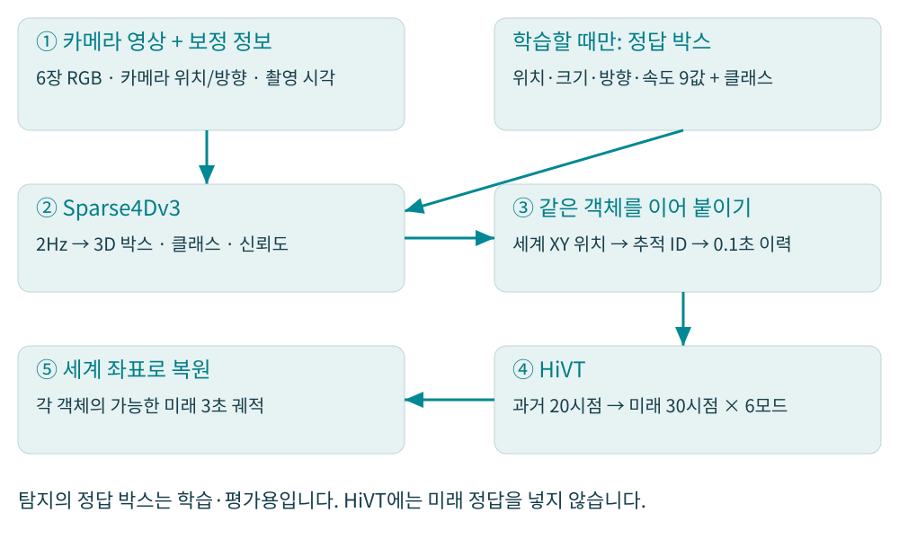
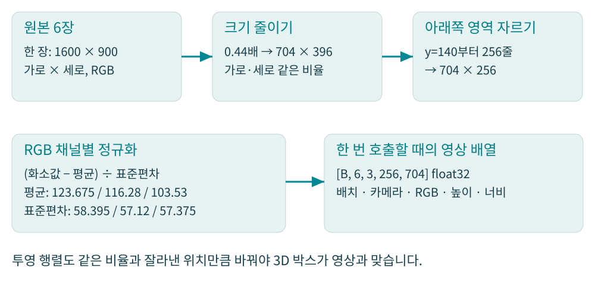
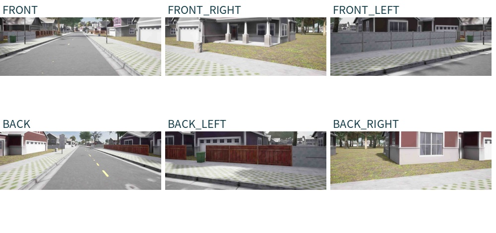
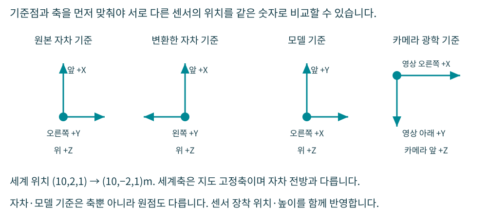
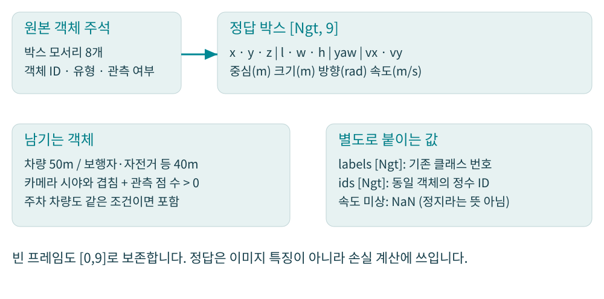
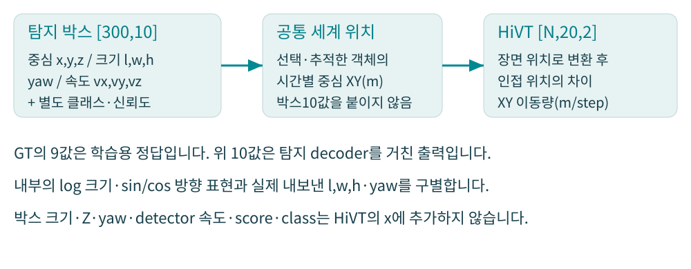
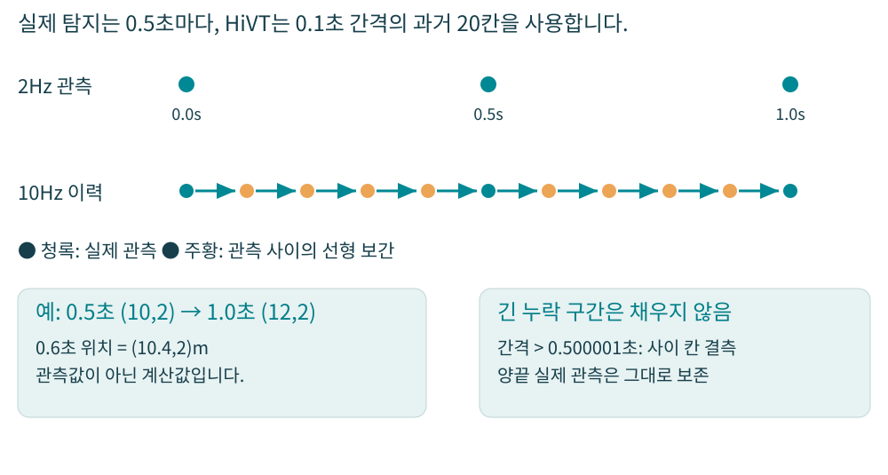
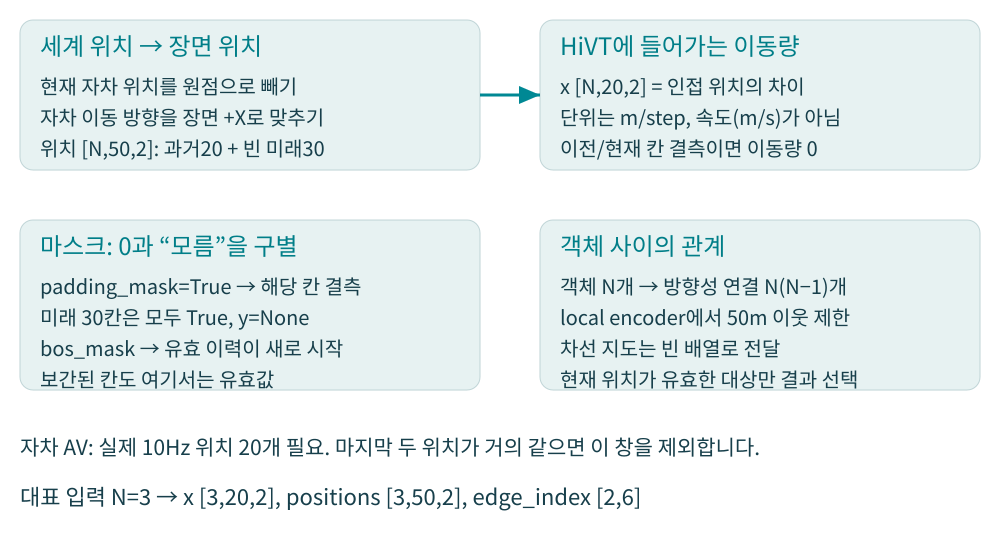
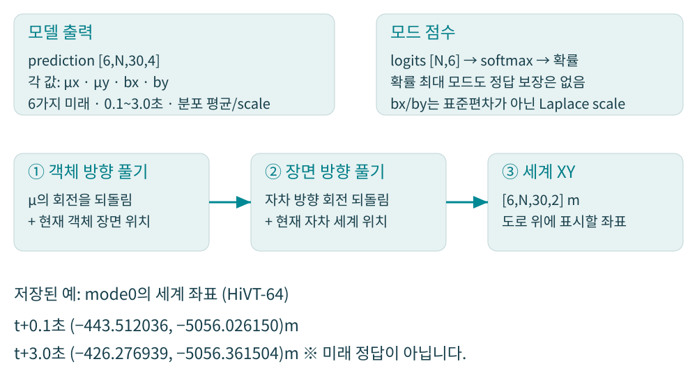

# Sparse4D → HiVT 상세인계서

이 자료는 **Bench2Drive로 미세조정한 2Hz Sparse4Dv3**의 입력·학습·출력과, 탐지된 객체를 **HiVT의 과거 이력으로 연결하는 과정**을 설명합니다. 각 단계에서 값이 왜 바뀌는지, 어떤 배열로 다음 모델에 들어가는지를 중심으로 정리했습니다.

**Sparse4D 가중치만 별도 제공합니다.** 선정 모델은 총 17epoch 중 검증 손실이 가장 낮았던 epoch12이며 현재 진행 중인 별도 10Hz 모델은 아닙니다. HiVT 가중치는 이 인계에 포함하거나 별도로 제공하지 않습니다. HiVT를 새로 실행하려면 수신자가 해당 모델 설정과 맞는 가중치를 확보해야 합니다. 저장된 입출력 예제는 가중치 없이도 읽을 수 있습니다.

설치와 실행 명령은 각 코드 저장소의 README에서 다룹니다. 여기서는 실행 경로보다 데이터의 의미·선택 이유·수치·제약을 설명합니다. 아래 성과 수치는 **이전 실험 기록**이며 인계 문서를 정리하면서 새로 학습·추론한 결과가 아닙니다.

## 1. 전체 흐름과 실험 범위

|항목|이 인계 자료에서 확인한 내용|
|---|---|
|탐지 모델|Sparse4Dv3 temporal ResNet-50. nuScenes 사전학습 탐지기에서 시작|
|데이터|Bench2Drive V0.0.4의 44시나리오 × 25클립 = 1,100클립|
|학습 / 검증 / 평가|835 / 221 / 44개 클립, 서로 다른 Town·Route 그룹|
|학습·탐지 입력 주기|2Hz, 같은 클립의 인접 입력 시각 차이 0.5초|
|모델 선정|221개 클립 전체 검증 손실 최저 epoch12, 손실 8.4877842531|
|종료|epoch13~17의 5회 연속 미개선으로 epoch17 종료|
|44개 클립 탐지 결과|GT가 존재하는 4개 클래스 평균 mAP 80.6114%|
|HiVT 입력|2Hz 탐지를 추적으로 연결하고, 관측된 구간 안에서 0.1초 격자로 선형 보간|
|HiVT 실행|미세조정 전·후 각각 44개 클립 × 3개 입력 창 × HiVT-64/128 = 528회 실제 추론|
|HiVT 검증 범위|엄격한 가중치 로딩, 입력·출력 형상, 유한값, 좌표 복원, 재실행 수치 일치 확인|
|입증하지 않은 사항|Bench2Drive 미래 정답 대비 HiVT 궤적 정확도, 지도 포함 성능, 실제 주행 안전성|

여기서 **클립**은 시나리오·Town·Route·날씨 등이 포함된 한 기록 묶음입니다. 1,100클립은 이 실험에서 내려받아 사용한 범위이며, Bench2Drive의 별도 10,000클립 Full 배포본 전체나 공식 220개 폐루프 평가 경로와 같은 집합이라는 뜻이 아닙니다. mAP는 저장된 영상의 3차원 객체 탐지 지표이며, 차량을 실제로 조종하는 폐루프 주행 점수가 아닙니다.

평가 44개 클립은 이 미세조정에서 gradient 계산이나 최저 epoch 선정에 넣지 않았습니다. 다만 이전 연구 과정에서 결과를 관찰한 자료이므로, 연구자가 한 번도 보지 않은 신규 평가 자료라고 표현하지는 않습니다. 이는 학습 데이터에 섞어 사용했다는 뜻과 구별해야 합니다.

### 데이터와 모델의 출처

데이터는 Bench2Drive V0.0.4의 44시나리오 × 25클립을 사용했습니다. 원격 배포본은 rethinklab/Bench2Drive-V0.0.4이며, 고정 버전·목록을 재현 기준으로 삼습니다. 최초 확보한 44클립의 정확한 취득 명령은 확인되지 않았고 나머지 1,056클립은 목록 기반으로 받았습니다. 1,100개 원본 압축파일은 약 415.36GB이며 압축 해제·캐시 공간은 별도입니다. 원본에서 279,032개 10Hz 시점, RGB 1,674,192장을 확인했습니다. 대용량 원본은 이 인계에 포함하지 않습니다.

탐지 모델은 HorizonRobotics/Sparse4D 계열의 Sparse4Dv3 temporal ResNet-50입니다. nuScenes 사전학습 탐지기 전체에서 시작했으며 파일의 최초 다운로드 명령은 확인되지 않았습니다. HiVT는 ZikangZhou/HiVT의 Argoverse 궤적 예측 모델입니다. 이전 실험은 HiVT-64·128을 사용했고 Bench2Drive로 재학습하지 않았습니다. 코드 출처·라이선스는 출처 안내와 각 저장소를 참고하면 됩니다.

### 시점과 분할

**입력**은 1,100클립의 원본 10Hz 프레임과 고정 분할 목록입니다. 연속 프레임을 임의로 섞으면 같은 도로 기록이 학습·평가에 동시에 들어갈 수 있으므로, 이 실험은 클립 목록을 먼저 고정하고 Town·Route 그룹의 분리 여부를 확인했습니다.

|역할|클립|Town·Route 그룹|2Hz 시점|용도|
|---|---:|---:|---:|---|
|학습|835|817|43,061|오차를 역전파하여 모델 갱신|
|검증|221|217|10,847|epoch별 전체 손실, 최저 모델 선정·조기 종료|
|평가|44|44|2,342|선정 모델의 탐지 AP 및 연결 실험|
|합계|1,100|1,078|56,250|6카메라 이미지 337,500장|

같은 Town·Route 그룹은 분할 사이에 겹치지 않습니다. 같은 Town 자체는 여러 분할에 있어 새로운 도시 평가라는 뜻은 아닙니다. seed=0 기록은 있지만 최초 목록 생성 절차 전체는 확정되지 않아 전달한 고정 목록을 재현 기준으로 삼습니다. 정적 GT 보정 후에도 같은 목록을 사용합니다.

원본 파일 번호를 프레임 ID로 사용하고, 5개마다 한 번인 0·5·10…번을 선택합니다. 시간은 원본 번호 × 0.1초이며 선택 후에는 0·0.5·1.0…초가 됩니다. 누락 프레임을 이어 붙여 시간을 다시 번호 매기지 않습니다. 속도는 원본 10Hz에서 이웃 시점 위치를 먼저 비교해 계산한 다음 2Hz로 선택하므로, 0.5초 간격의 위치 차이를 0.1초 속도로 잘못 계산하지 않습니다. 모든 원본 자차 pose는 HiVT 연결을 위해 `poses_10hz.json`에 별도로 남깁니다.

## 2. 영상·좌표·정답을 같은 기준으로 준비하기

### 한 시점에 읽는 정보

카메라 영상은 6장, 각각 1600×900 RGB입니다. 주석에는 객체의 8개 박스 모서리·종류·ID·자차 위치와 방향·센서 보정값·객체 관측 점 수가 들어 있습니다. 모델 입력은 RGB이며 LiDAR 점군·Depth 영상을 넣지 않습니다. 다만 LiDAR 기준 좌표의 메타데이터와 관측 점 수는 변환·GT 선택에 사용합니다.

### 공식 Dataset과 영상 처리 순서

**입력**은 `sparse4d_infos.pkl`에 연결된 원본 6카메라 RGB와 보정 정보입니다. 이 분기는 자체 resize로 비슷한 입력을 만드는 대신, 실제 Sparse4D `NuScenes3DDetTrackDataset`과 설정의 `test_pipeline`을 호출했습니다. 이름이 test pipeline인 이유는 **고정된 이미지 기하 변환**을 사용하기 위해서이며, 평가 영상을 학습에 넣었다는 뜻이 아닙니다.

처리 순서는 이미지 읽기 → ResizeCropFlipImage → NormalizeMultiviewImage → NuScenesSparse4DAdaptor → Collect입니다. 원본 BGR 읽기와 `to_rgb=True`를 함께 적용하여 모델 입력은 RGB가 됩니다. 1600×900 영상을 비율 0.44로 **704×396**으로 줄이고, 세로 시작점 y=140에서 704×256을 잘라냅니다. 이 고정 처리에서는 수평 반전과 임의 회전을 하지 않습니다. 영상 크기만 바꾸는 것이 아니라 투영 행렬도 같은 resize·crop을 반영해야 합니다.

정규화는 채널별 `(값 − 평균) / 표준편차`입니다. 평균은 RGB 순서 `[123.675,116.28,103.53]`, 표준편차는 `[58.395,57.12,57.375]`입니다. 출력 `img`는 `[6,3,256,704]` float32입니다. 학습 시에도 이 고정 캐시를 사용하며, 모델 내부 GridMask는 별도로 활성화합니다. 따라서 공식 nuScenes 학습 스크립트의 모든 무작위 영상 증강을 그대로 재현했다고 표현하지 않습니다.

**uint8 캐시가 입력을 손실 없이 복원하는 이유**

학습에서 매번 JPEG를 열고 같은 연산을 반복하지 않도록, 처리된 RGB를 uint8 캐시에 저장했습니다. 정규화된 소수를 8비트로 근사 저장한 것이 아닙니다. 가능한 0~255 화소 각각을 **실제 MMCV 정규화 함수**로 계산한 표(LUT, lookup table)를 만들고, 이 표로 원래 float32 정규화 결과를 정확히 복원합니다.

각 시점의 모든 화소에 대해 공식 처리 결과와 캐시 복원 결과가 모든 원소에서 정확히 같은지 검사했습니다. 1,100클립의 56,250시점·337,500카메라 이미지에서 이 비교를 수행한 기록이 있습니다. 이 확인은 정규화 캐시의 정확한 일치를 뜻하며, 데이터 도메인 차이나 카메라 가림 문제까지 없다는 뜻은 아닙니다.

**출력 파일**은 `rgb.npy` `[F,6,3,256,704]` uint8, `meta.pkl`(시점별 투영·크기·시간·세계 변환), `normalization_lut.npy` `[3,256]` float32입니다. F는 해당 클립의 선택된 2Hz 시점 수입니다. 학습할 때 필요한 부분을 메모리 매핑으로 읽고 GPU에서 LUT를 조회합니다.

### 실제 모델 호출에 들어가는 값

B는 서로 다른 클립을 한 번에 묶는 배치 크기입니다. 학습에서는 최대 4, 검증·최종 추론에서는 1입니다.

|이름|형상 / 자료형|내용|
|---|---|---|
|img|`[B,6,3,256,704]` float32|정규화된 RGB|
|projection_mat|`[B,6,4,4]` float32|모델 기준 3D→resize/crop 후 픽셀 투영|
|image_wh|`[B,6,2]` float32|각 영상의 `[704,256]`|
|timestamp|`[B]` float64|초. 인접 입력 간격 0.5초|
|img_metas|길이 B의 dict 목록|`T_global`, `T_global_inv`; 학습 시 instance_id 포함|
|gt_bboxes_3d|B개 float32 배열|학습·검증 손실용 박스 표적|
|gt_labels_3d|B개 int64 배열|학습·검증 손실용 클래스|

정보 파일의 timestamp는 원래 nuScenes 관례의 마이크로초로 저장하고, 공식 Dataset/Adaptor를 지난 모델 입력은 초 단위로 통일됩니다. 숫자를 그대로 0.5가 아니라 500000으로 모델에 넣지 않습니다. 추론에서는 위 표 마지막 두 GT 필드와 instance_id 정답을 전달하지 않습니다.

입력 전달 단계는 CPU에서 읽은 uint8 영상과 메타데이터, 별도 GT를 CUDA 텐서로 옮깁니다. 실제 `forward_train`은 RGB·투영·시간·세계 pose로 예측을 만들고 GT로 손실을 계산합니다. GT가 이미지 특징처럼 detector 입력으로 유입되는 구조와 구별해야 합니다.

*대표 시점의 실제 저장 RGB 캐시. 원본이 아니라 이미 704×256으로 줄이고 잘라낸 영상입니다.*

### 좌표계를 먼저 정의하는 이유

**입력**은 CARLA의 원본 위치(자차 기준 앞 X·오른쪽 Y·위 Z)와 `world2ego`, `world2lidar`, `world2cam` 행렬, 각 카메라의 intrinsic입니다. Sparse4Dv3의 3차원 위치와 영상 투영을 일치시키려면 위치 값만 뒤집는 것이 아니라 객체·자차·센서 변환을 같은 규칙으로 바꿔야 합니다.

|기호|의미|축·단위|
|---|---|---|
|U|원본 CARLA 세계 좌표|원본 축 방향, m|
|G|공통 세계 좌표|원본 Y 부호를 반전, m|
|E|자차 좌표|앞·왼쪽·위, m|
|L|모델이 사용하는 LiDAR 기준 좌표|오른쪽·앞·위, m. 점군 입력을 뜻하지 않음|
|C|카메라 광학 좌표|오른쪽·아래·앞, m|
|K|카메라 내부 행렬|광학 좌표를 픽셀로 투영|

세계 좌표는 도로에 고정된 축이며 자차가 회전해도 함께 회전하지 않습니다. 원본 세계 위치가 (10,2,1)m라면 공통 세계 위치는 (10,−2,1)m입니다. Y 부호를 바꾸는 것은 축의 반사이고 그 자체가 회전은 아닙니다. 자차 기준은 차체를, 모델 기준은 LiDAR 기준점을 원점으로 삼으므로 축뿐 아니라 원점 높이·이동도 함께 고려합니다.

카메라에서는 +X가 영상 오른쪽, +Y가 영상 아래, +Z가 카메라 앞입니다. 모델 기준 3D 점을 해당 카메라 기준으로 이동·회전한 뒤 카메라 내부 행렬을 적용하고 깊이로 나누어 픽셀 위치를 얻습니다. 위치뿐 아니라 박스 방향·속도·자차 및 센서 변환까지 같은 기준으로 맞춰야 합니다. 여섯 카메라는 각자의 보정값을 사용합니다.

**카메라 순서와 투영 검증**

카메라 순서는 **FRONT → FRONT_RIGHT → FRONT_LEFT → BACK → BACK_LEFT → BACK_RIGHT**입니다. 이미지 배열과 투영 행렬 배열이 이 순서를 함께 지켜야 합니다. 순서가 어긋나면 텐서 형상이 맞아도 전혀 다른 영상 위치에서 특징을 읽게 됩니다.

원본 세계 좌표에서 직접 카메라로 옮긴 결과와, 세계→모델 기준→카메라로 옮긴 결과를 비교했습니다. 외부 행렬의 역변환, 카메라 위치, 최종 회전 행렬, 이미지 크기 변경 후 투영 경로도 검사했습니다. 이는 **구현상의 좌표·투영 일관성 검증**입니다. 센서의 물리적 보정 오차를 별도 재측정했다는 의미나, 화면 속 객체가 가려졌는지까지 완전히 확인했다는 의미는 아닙니다.

**출력**은 각 시점의 `sparse4d_infos.pkl` 안에 카메라 이미지 경로, intrinsic, sensor2lidar·sensor2ego·ego2global 회전/이동, timestamp, token으로 저장됩니다. 공식 Dataset이 이 정보를 받아 이미지 변환에 맞춘 투영 행렬을 만듭니다.

### 원본 박스에서 공통 GT로

**입력**은 객체별 `world_cord`의 8개 3차원 모서리, 유형, ID와 관측 정보입니다. GT(Ground Truth)는 학습·평가에 사용하는 정답입니다. 객체 중심은 8모서리 평균, 길이·폭·높이는 서로 마주 보는 면 중심 사이 거리로 구하고, 길이 방향을 heading으로 삼습니다. 좌표를 공통 세계 좌표로 바꾼 뒤 yaw는 수평 방향 각도(rad)로 표현합니다. 치수가 0에 가깝거나 값이 유한하지 않은 박스는 정상 표적으로 쓰지 않습니다.

클래스는 car, truck, bus, pedestrian, bicycle, motorcycle의 공통 6종입니다. walker는 pedestrian, van은 car로 연결합니다. 식별 가능한 정적 주차 차량도 car로 연결합니다. 실제 이 데이터의 선택·필터링 후 GT에서는 **bus와 motorcycle이 0건**이었습니다. 출력 head를 4개 클래스로 바꾼 것이 아니고, 6종 정책에 포함되어 있어도 두 클래스의 양성 표적이 없었던 것입니다.

|분할|car|truck|pedestrian|bicycle|bus / motorcycle|
|---|---:|---:|---:|---:|---:|
|학습|293,471|618|2,203|6,166|0 / 0|
|검증|70,338|108|553|1,668|0 / 0|
|평가 44|16,999|26|190|441|0 / 0|

건수는 고유 객체 수가 아니라 **객체가 프레임에 등장한 횟수**입니다. 동일 차량이 10프레임에 등장하면 10건입니다. 이 분포는 car가 많다는 것을 보여주며, bus·motorcycle의 미세조정 효과를 입증하는 데이터는 아닙니다.

**실제 적용한 필터와 정적 차량 보정**

차량은 자차 기준 수평거리 50m, 보행자·자전거·오토바이는 40m 범위로 제한했습니다. 박스가 하나 이상의 카메라 시야와 겹치는지, 원본 주석의 LiDAR 관측 점 수가 양수인지도 확인했습니다. 시야 검사는 카메라 뒤쪽의 모서리·선을 near plane에서 잘라 투영하고 영상 범위와 겹치는지 보는 방식입니다. **다른 물체에 가려졌는지 판단하는 occlusion 검사는 아닙니다.**

이전 변환에서는 `state == static`인 객체를 일괄 제외하는 조건이 있었습니다. epoch12 모델에 쓰인 수정 전처리는 이 사유만 제거했습니다. 거리·카메라 시야·관측 점 수 조건은 그대로 유지했습니다. 따라서 정적 차량이 포함되었다고 해서 모든 원본 객체를 무조건 GT에 추가한 것은 아닙니다.

`legacy_valid_mask`와 `legacy_ignore_reasons`는 이전 선택 결과를 보존하는 필드입니다. 최종 `valid_mask`가 참인 객체만 학습 표적에 포함합니다. 이 변경으로 학습 39,978건, 검증 7,449건, 평가 44 3,301건의 정적 객체-프레임이 추가되었습니다. 학습·검증·평가에 같은 수정 GT 정의를 사용했습니다.

### 속도와 9개 값의 박스 표적

같은 ID의 이전 원본 프레임이 정확히 0.1초 전일 때 `(현재 세계 위치 − 이전 세계 위치) / 0.1`로 속도(m/s)를 구했습니다. teleport·disappear 표식, 연속성, 비현실적인 큰 속도 검사를 통과하지 못하면 속도를 미상으로 남겼습니다. 첫 프레임처럼 이전 관측이 없는 경우도 0m/s라고 단정하지 않습니다.

이 검사에서 원본 객체 ID가 앞선 프레임에도 존재하고 시간 연속성이 맞아야 합니다. 크기 80m/s 미만 조건을 통과한 경우만 속도 유효 표시를 켭니다.

GT 세계 위치를 `G_L`의 역행렬로 모델 기준 좌표로 옮기고, 수평 heading과 속도도 같은 기준에 맞춥니다. 저장된 학습 표적은 다음과 같습니다.

|필드|형상 / 자료형|뜻|
|---|---|---|
|boxes|`[N_gt, 9]` float32|`x,y,z,l,w,h,yaw,vx,vy`; 위치·크기 m, yaw rad, 속도 m/s|
|labels|`[N_gt]` int64|기존 nuScenes head의 클래스 인덱스 유지|
|ids|`[N_gt]` int64|클립 내부의 원본 객체 ID를 안정적으로 정수화|

라벨 인덱스는 car=0, truck=1, bus=3, motorcycle=6, bicycle=7, pedestrian=8입니다. 기존 10클래스 head의 위치를 유지하며 0~5로 다시 매기지 않습니다.

속도 미상은 boxes의 마지막 두 값에 NaN으로 저장합니다. 앞의 7개 기하 값은 반드시 유한해야 합니다. 박스 크기는 양수여야 하고 GT가 없는 프레임도 빈 `[0,9]` 배열로 보존합니다. 그 프레임을 데이터셋에서 삭제하지 않습니다. 학습 표적은 `targets.pkl`, 평가 GT는 `gt_common.jsonl`에 별도로 저장하여 추론 입력과 분리합니다.

**과거 구현의 한계: 속도 미상의 매칭 비용**

2Hz epoch12 실행 당시 공식 matcher의 비용 계산에는 **NaN × 0도 NaN으로 남는 문제**가 있었습니다. 속도에 0 가중치를 주더라도 미상값이 먼저 계산되면 전체 비용이 NaN이 될 수 있고, 공식 코드는 비정상 비용을 큰 값으로 바꾼 후 Hungarian matching을 합니다. 이 때문에 미상 속도가 있는 객체의 학습 대응이 영향을 받았을 가능성이 있습니다. 실제 영향을 정량적으로 분리한 실험은 이 2Hz 분기에서 수행하지 않았습니다.

회귀 손실의 NaN 처리와 이보다 앞선 matching 비용 계산은 다른 단계입니다. 뒤에서 NaN 표적을 마스킹했다고 앞 단계의 문제가 자동으로 해결되는 것은 아닙니다. 이 인계는 **과거 결과를 만든 학습 구현을 보존**합니다. 이 한계를 고쳐 재학습한 모델로 대체한 것은 아닙니다. 별도 10Hz 분기에서 이 비용 계산을 보완했지만 해당 구현·가중치는 이번 2Hz 인계 대상이 아닙니다. 저장된 44개 클립 AP를 재계산할 때는 학습 matching을 수행하지 않으므로, 보고한 AP 계산 결과 자체와 이 학습상의 한계는 구분합니다.

## 3. Sparse4Dv3를 학습하고 탐지 결과를 해석하기

### 초기 모델과 학습 대상

**입력**은 nuScenes 사전학습 Sparse4Dv3 R50 전체 가중치입니다. backbone만 ImageNet으로 초기화한 뒤 detector를 새로 학습한 실험이 아닙니다. 모델을 만들 때 backbone의 별도 pretrained 옵션을 끄고 전체 checkpoint를 `strict=True`로 읽었습니다. state_dict의 819개 항목이 일치하며, 이 수에는 학습 파라미터뿐 아니라 buffer도 포함됩니다.

대부분의 backbone·검출 head를 미세조정합니다. Depth branch는 동결하고 평가 모드로 고정했습니다. Depth GT를 제공하지 않아 깊이 감독 손실을 사용하지 않았습니다. 10클래스 head의 차원을 바꾸지 않고, 공통 6클래스에 해당하는 분류 손실 채널만 활성화했습니다. bus·motorcycle도 정책에 포함되지만 양성 GT가 없으므로 해당 클래스에 대한 충분한 학습이 되었다고 볼 수 없습니다.

**학습 목적에 맞춘 처리**

- **분류 손실 채널 선택:** 기존 10클래스 분류 출력에서 공통 6종의 손실 채널만 선택합니다. 추론 출력 head 자체를 6개로 잘라 다시 만든 것은 아닙니다.
- **깊이 분기 동결:** 사용하지 않는 깊이 감독 경로를 학습 대상에서 제외합니다.
- **미상 속도가 있는 정답의 보조 학습 처리:** 박스의 모든 성분이 유한한 GT만 noisy target 생성에 전달합니다. DN(denoising)은 잡음을 더한 GT를 사용해 query 학습을 돕는 학습 분기입니다. 미상 속도를 가진 GT를 이 보조 분기에서만 제외하며 일반 matching 전체에서 삭제하는 처리는 아닙니다.
- **중간 단계 분류 출력 유지:** 검증에서 `eval()`을 유지하면서 중간 decoder 단계의 분류 출력도 받아 동일 항목의 검증 손실을 계산합니다. 검증을 위해 모델을 통째로 `train()`으로 바꾸면 Dropout·BatchNorm·DN 동작까지 달라지므로 이를 피하기 위한 처리입니다.

이는 실행 시 함수 래핑과 별도 학습 엔진의 변경입니다. Sparse4D 공식 소스에는 CUDA 호환성을 위해 CUDA 집계 연산의 원자 연산 헤더를 THC 계열에서 ATen 계열로 바꾸는 포팅도 적용했습니다. 당시 사용한 MMCV 1.7.1 소스도 함께 포함했습니다. 호환성 수정과 학습 방법의 변경을 같은 것으로 설명하지 않습니다.

**배치와 시계열 이력을 유지하는 방법**

서로 길이가 같은 클립끼리 묶고 각 클립의 시각 순서를 유지합니다. 4개를 묶으면 배치의 각 행은 서로 다른 클립의 한 시계열이며, 다음 호출에서는 각 클립의 다음 0.5초 시점을 넣습니다. 길이별로 남는 클립 수에 따라 실제 배치는 4·2·1이 됩니다. 한 클립의 임의 시점들을 배치 4라고 묶지 않습니다.

900개 anchor 중 최대 600개 시계열 instance를 유지하는 원래 instance bank를 사용하며 confidence decay는 0.6, 기본 시간 간격은 0.5초입니다. 클립 그룹이 바뀔 때 instance bank와 DN 이력을 초기화하여 다른 클립의 상태가 섞이지 않게 합니다. 입력 묶음은 같은 클립 내 meta·GT·RGB 길이와 token, 연속 0.5초 간격을 확인합니다.

### optimizer와 실제 업데이트

|항목|실제 설정|
|---|---|
|정밀도 / seed|FP32, TF32 비활성, seed=0|
|optimizer|AdamW|
|기본 학습률 / backbone|2×10⁻⁵ / 2×10⁻⁶|
|weight decay|0.001|
|gradient clipping|노름 25|
|실제 배치|최대 4, 동일 길이 그룹의 잔여에 따라 2·1|
|누적 gradient|목표 8프레임, 그룹 마지막 잔여는 실제 개수로 정규화|
|학습률 변화|100epoch 기준 cosine, 최저 비율 0.01|
|검증|221개 클립 전부, batch1, gradient 갱신 없음|
|최대 epoch / patience|100 / 전체 검증 손실 5epoch 연속 미개선|

학습률은 epoch e에서 `0.01 + 0.99×(1+cos(π×(e−1)/100))/2` 비율을 적용합니다. seed는 고정했지만 GPU·라이브러리·배치가 달라졌을 때 학습 전체가 비트 단위로 같다고 보장하지는 않습니다.

손실에 배치 크기를 곱하고 8로 나눈 값을 역전파합니다. 실제 누적 개수가 8과 다르면 gradient를 다시 보정하고 노름을 제한한 뒤 optimizer step을 수행합니다. 그룹 마지막의 남은 프레임도 같은 방식으로 실제 개수에 맞춰 업데이트합니다. 검증 시에는 optimizer를 전달하지 않아 `torch.set_grad_enabled(False)`로 계산합니다.

**손실의 뜻과 선정 기준**

손실은 물리 단위 하나로 표현되는 값이 아닙니다. 분류 Focal loss, 박스 L1, centerness, yawness와 학습 시 DN 항을 가중 합산한 목적함수입니다. 분류 Focal loss는 gamma=2, alpha=0.25, weight=2입니다. 박스 L1 weight는 0.25이고, 위치·log 크기·sin/cos heading·속도 같은 서로 다른 표현이 들어갑니다. decoder 6단계의 항들을 합칩니다. 양성 수로 정규화하는 방식과 항목별 가중치가 있으므로 ‘loss 8.49m’처럼 해석하면 안 됩니다.

학습에서는 DN 항이 존재하고 검증에서는 없는 등 경로가 다르므로, train loss가 validation loss보다 크다는 사실만으로 오류라고 단정할 수 없습니다. 동일 조건의 epoch별 전체 검증 손실을 비교해 모델을 선택했습니다. 배치 크기가 다른 과거 실험의 손실도 BatchNorm·양성 수 정규화 때문에 숫자만 직접 비교해서는 안 됩니다.

초기 가중치의 epoch0 검증 손실은 16.2447775977입니다. 아래는 실제 전체 221개 클립 검증 결과입니다. 

|epoch|전체 validation loss|의미|
|---:|---:|---|
|0|16.2447775977|학습 전|
|1|10.4377515922||
|2|10.2114955577||
|3|9.5609406162||
|4|9.4608591486||
|5|9.1200448251||
|6|8.9969858933||
|7|8.9986293710||
|8|9.2230088005||
|9|8.8534894428||
|10|9.4160131644||
|11|9.0083581288||
|12|8.4877842531|선정 모델|
|13|8.5540591877||
|14|8.6029571208||
|15|8.9964133073||
|16|8.7702488715||
|17|8.9050517404|5회 미개선으로 종료|

최저 epoch12의 검증 손실은 **8.4877842531**, 해당 epoch의 train loss는 **10.5396705656**입니다. epoch13~17이 이를 개선하지 못해 종료했습니다. 선정은 중간 8클립의 비교 loss나 평가 44 AP가 아니라 **전체 221개 클립 검증 loss**로 했습니다. 당시 추가로 계산한 작은 검증 부분집합의 이전 가중치 비교는 연구 관찰용이었습니다.

선정 epoch12 파일은 모델 상태·epoch·검증 손실·프로토콜을 담는 배포용입니다. optimizer 상태가 없어 동일 AdamW 상태의 학습 재개 파일과 다릅니다. 모델 구조를 변경한 새 실험과 이전 가중치를 구분해야 합니다.

**탐지 평가의 입력**

**입력**은 평가 44개 클립의 공식 RGB 캐시와 pose, 선정 epoch12 가중치입니다. 각 클립을 처음부터 끝까지 시간순으로 batch1, FP32, TF32 비활성 조건으로 추론했습니다. 3회 준비 호출 후 instance bank를 초기화하고 실제 시점 0부터 다시 시작했습니다. 준비 호출을 평가 프레임으로 세지 않았습니다.

### detector가 직접 내는 출력

검출기가 반환하는 한 시점의 결과는 다음과 같습니다.

|필드|대표 형상|의미|
|---|---|---|
|boxes_3d|`[300,10]` float32|모델 기준 `x,y,z,l,w,h,yaw,vx,vy,vz`|
|scores_3d|`[300]` float32|분류·centerness를 반영한 신뢰도|
|labels_3d|`[300]` int64|원래 nuScenes 클래스 인덱스|
|instance_ids|`[300]` 정수|모델 내부 instance 식별자|

설정의 top300을 반환하며, 크기는 exp, yaw는 sin/cos에서 atan2로 복원합니다. 이 출력에 별도 NMS를 더하지 않았습니다. 이후 세계 좌표 변환과 클래스·거리 평가 조건을 적용합니다. HiVT용 score≥0.2 조건은 다음 연결 단계의 조건이며, 이 값으로 AP 예측을 미리 잘랐다고 혼동하면 안 됩니다.

탐지 결과를 저장할 때는 모델 기준 중심·heading·속도를 공통 세계 좌표로 바꾸고 JSONL의 각 시점에 `episode_id`, `sample_token`, `timestamp`, `objects`를 기록합니다. 객체에는 `class`, `center_xyz`(m), `size_lwh`(m), `yaw`(rad), `velocity_xy`(m/s), `score`, `coordinate_frame='world_rh'`, `track_id`가 들어갑니다. 이 detector의 track_id를 그대로 HiVT 이력의 영구 ID로 쓰지는 않았습니다.

### mAP의 정확한 정의와 수치

AP(Average Precision)는 신뢰도 순으로 탐지를 정렬하여 정밀도·재현율 곡선으로 계산한 클래스별 점수이며, mAP는 이를 클래스별로 평균한 값입니다. 정밀도는 검출한 것 중 맞은 비율, 재현율은 정답 중 검출한 비율입니다.

nuScenes-devkit 1.2.0의 `accumulate`, `calc_ap`, `calc_tp`를 사용했습니다. 위치 정합은 **세계 XY 중심 거리** 기준 0.5·1·2·4m이며, 최소 precision·recall은 각각 0.1입니다. 44개 클립의 **2,342프레임을 합쳐** 클래스별 precision-recall 곡선을 만들었습니다. 프레임별 mAP나 클립별 mAP의 산술평균이 아닙니다.

|클래스|평가 GT|AP (%)|
|---|---:|---:|
|car|16,999|84.6110|
|truck|26|72.1823|
|pedestrian|190|87.3654|
|bicycle|441|78.2871|
|bus|0|평가 불가|
|motorcycle|0|평가 불가|
|GT가 있는 4개 클래스 평균|17,656|**80.6114**|

GT가 없는 클래스는 0점으로 평균에 넣지 않습니다. 따라서 이 수치는 ‘nuScenes 공식 10클래스 mAP’ 또는 ‘전체 6클래스 성능 입증’이라고 부르지 않습니다. truck은 GT가 26건뿐이므로 높은 AP라도 표본 수의 한계를 함께 봐야 합니다. NDS와 주행 점수도 측정하지 않았습니다.

같은 수정 GT로 저장된 사전학습 예측을 평가한 mAP는 32.9214%, 이전 중간 미세조정 모델(epoch7)은 68.9827%였습니다. 다만 사전학습 저장 예측은 이전 수동 입력 처리, epoch12는 공식 입력 처리와 정적 GT 보정 학습을 사용했습니다. **32.92→80.61%를 오직 가중치 미세조정 한 가지의 순수 인과 효과로 단정할 수 없습니다.**

이 2Hz 분기에서 전체 221개 검증 클립의 mAP와 1,100전체클립의 미세조정 후 mAP를 측정한 결과는 없습니다. 검증에는 전체 loss가 있고, 선정 모델의 최종 탐지 AP는 평가 44에 대해 존재합니다. 진행 중인 10Hz 후속 평가의 숫자를 여기에 채워 넣지 않습니다.

## 4. 탐지 위치를 20칸의 과거 이동 이력으로 바꾸기

### 객체 선택과 별도 추적

**입력**은 2Hz detector JSONL입니다. HiVT는 한 시점의 3D 박스 목록만으로 다음 위치를 예측하는 모델이 아니므로, 같은 객체가 시간에 따라 어디로 움직였는지 연결해야 합니다. 이 실험은 `CommonTracker`를 사용했습니다.

신뢰도 0.2 미만을 제외하고, 이전 객체의 속도로 다음 중심을 예상한 뒤 같은 클래스끼리 세계 XY 거리 4m 미만인 경우 Hungarian assignment로 연결합니다. 마지막 관측 후 1초를 넘긴 track은 제거합니다. 클립이 바뀌면 추적 상태를 초기화하고 새 ID를 부여합니다. 연결 비용에서 속도를 쓰지만, 출력 이력의 위치는 관측된 detector 중심입니다. GT 객체 ID나 GT 중심으로 추적을 보정하지 않았습니다.

속도가 제공되지 않을 때는 두 관측 위치의 차이/시간으로 계산하고, 그마저 없으면 초기 0으로 둡니다. 이 fallback은 추적 예측을 위한 값이며 ‘정답 속도가 0’이라는 뜻이 아닙니다. 모델 내부 instance_id 대신 공통 tracker를 사용했기 때문에 ID가 바뀌거나 합쳐질 가능성은 별도로 남습니다.

### 2Hz 탐지와 HiVT 10Hz 시간 격자

HiVT 사전학습 설정은 과거 20개 시점을 0.1초 간격으로 받습니다. 포함되는 시각은 현재 t를 포함해 **t−1.9, t−1.8, …, t**이며, 첫 관측과 마지막 관측 사이 시간은 1.9초입니다. 이 실험의 detector는 0.5초 간격이므로 그 사이를 채우는 별도 처리가 필요했습니다.

현재 연결 방식은 격자 시각에 해당하는 **실제 관측점부터 보존**합니다. 그 밖의 시각은 객체별로 두 실제 관측 사이에서만 선형 보간합니다. 가장 이른 관측 이전과 가장 늦은 관측 이후를 외삽하지 않습니다. 두 관측 간격이 0.500001초보다 크면 그 사이를 보간하지 않지만 양끝의 실제 관측은 보존합니다. 미래 GT나 현재 시각 이후의 detector 예측을 쓰지 않습니다. 자차 AV(autonomous vehicle) 위치는 별도 `poses_10hz.json`의 실제 0.1초 pose를 사용합니다.

예를 들어 실제 위치가 0.5초에(10,2), 1.0초에(12,2)라면 0.6초에는(10.4,2)가 됩니다. 이 값은 **관측된 10Hz detector 위치가 아니라 보간값**입니다. 양끝이 둘 다 현재 이전이면 과거 정보만 사용하지만, 그 사이 실제 움직임이 선형이었다는 보장은 없습니다. 보간으로 가속·급회전의 세부 정보가 새로 생기지는 않습니다.

이전 실험은 각 클립에서 최초 3개의 적격 창만 사용했습니다. 현재 연결 방식은 현재 관측된 car 중 필요한 이력이 있고, 최종 입력 텐서에서도 현재 위치가 유효하며 `prediction_eligible=True`인 객체를 대표 AGENT로 고릅니다. 그래프에는 다른 추적 객체와 AV도 포함됩니다. 완전한 AV 이력이 없거나 AV가 거의 정지해 이동 방향을 구할 수 없는 창은 건너뜁니다. 전·후 모델은 탐지 객체가 달라 **선정 시각·객체가 서로 다를 수 있습니다**. 따라서 528회 forward 성공을 같은 미래 정답에 대한 공정한 전·후 궤적 정확도 비교로 해석해서는 안 됩니다.

### 장면 좌표 변환과 텐서 생성

HiVT 이력 변환의 입력은 클립ID·timestamp·track_id·center_xyz·world_rh·valid_mask를 가진 기록 목록입니다. 20시점의 동일한 0.1초 격자, 중복 ID/시각, 유한한 좌표를 검사합니다. 정렬된 track_id별로 행 번호를 정해 `[N,50,2]` 위치 배열을 만듭니다. 앞 20은 과거, 뒤 30은 미래 자리이며 실제 미래 정답을 채우지 않습니다.

현재 AV 위치를 장면 원점으로 잡고, 마지막 두 AV 위치에서 구한 이동 방향(heading)을 x축 방향으로 맞춥니다. 현재 AV가 정지하여 heading이 불명확하면 별도 pose-yaw 대체 정책을 쓰지 않고 오류로 처리해 해당 창을 제외했습니다. 이 선택 때문에 모든 장면을 포괄하는 연결 시험은 아닙니다.

`positions`는 장면 기준 위치(m), `x`는 **인접 시점 위치의 차이(m/step)**입니다. 0.1로 나눈 m/s 속도가 아닙니다. 두 시점 중 하나가 비어 있으면 해당 이동량은 0으로 둡니다. `padding_mask=True`는 유효한 관측이 없음을 뜻하고, 0이라는 숫자가 실제 원점 관측인지 결측인지 이 마스크로 구분합니다. 보간으로 채운 값은 여기서는 유효 위치로 처리되며 ‘보간 여부’의 별도 마스크는 HiVT에 전달하지 않습니다.

`bos_mask`는 새 이력의 시작점, `rotate_angles`는 각 객체의 마지막 두 유효 위치로 얻은 이동 방향입니다. 서로 다른 두 객체의 모든 순서쌍으로 `edge_index`를 만듭니다. 이후 HiVT 내부가 마스크를 적용하고 local encoder가 50m 이웃 거리 제한을 적용합니다. 이 50m는 모든 global interaction 연결을 잘라내는 전역 반경이 아닙니다. `prediction_eligible`는 현재 관측이 있고 두 개 이상 유효 위치가 있는 객체를 뜻하는 결과 선택용 표시입니다. 이 표시만으로 모델 내부의 모든 계산 노드를 제거하지는 않습니다.

|최종 필드|형상 / 자료형|의미·단위|
|---|---|---|
|x|`[N,20,2]` float32|장면 좌표의 위치 변화량, m/step|
|positions|`[N,50,2]` float32|장면 좌표 m. 뒤 30은 0이며 마스크 참|
|padding_mask|`[N,50]` bool|참이면 결측·미래 자리|
|bos_mask|`[N,20]` bool|이력 시작 시점|
|rotate_angles|`[N]` float32|객체별 heading, rad|
|edge_index|`[2,N(N−1)]` int64|객체 간 방향성 연결 인덱스|
|origin / theta|`[1,2]` float64 / scalar|세계 원점 m / 장면 heading rad|
|av_index / agent_index|정수|자차 / 대표 대상 객체 행 번호|
|y|None|미래 정답 입력 없음|

기존 detector의 score·class는 선택/연결에 사용하지만 HiVT 신경망의 별도 feature로 전달하지 않았습니다. 3D 크기·yaw·Z·detector 속도도 HiVT의 x 입력에 그대로 이어 붙이지 않았습니다. HiVT가 실제로 받는 핵심은 평면 위치 변화와 이력·객체 관계입니다.

## 5. HiVT의 미래 출력과 세계 좌표 복원

**지도 없는 연결 시험을 명시한 이유**

공식 HiVT는 차선 벡터와 객체-차선 관계도 활용합니다. 이 실험에서는 Bench2Drive Town의 차선 그래프를 연결하지 못해, **빈 차선 텐서를 명시적으로 전달한 지도 없는 연결 시험**을 수행했습니다. 일반 지도 연결 경로는 지도 누락을 오류로 처리하지만, 이 연결 시험은 별도 경로에서 빈 지도 배열을 구성했습니다. ‘실제 지도가 완전히 처리되었다’고 설명하면 안 됩니다.

차선 벡터와 lane_actor 관계가 0개이므로 차선 기반 정보가 제공되지 않습니다. 이 상태에서도 객체 간·시간축 계산과 미래 궤적 생성이 가능한지 확인한 것입니다. 지도까지 포함한 정상 배포 성능으로 해석할 수 없습니다.

### 사용 모델과 실제 수정 사항

HiVT-64와 HiVT-128의 숫자는 embedding 차원입니다. 두 모델 모두 과거 20시점, 미래 30시점, 6개 모드, node/edge 차원 2, attention head8, temporal layer4, global layer3, local radius50m를 사용했습니다. `rotate=True`로 객체별 heading에 맞춘 표현을 쓰고, 추론은 `eval()`로 수행했습니다.

HiVT에는 실행 환경에 맞춘 호환성 수정이 있습니다. TorchMetrics의 없어진 compute_on_step 인자를 제거하고, PyTorch의 is_causal 인자를 받도록 하되 기존 causal mask 처리는 유지했습니다. 연결 어댑터만 바뀐 것은 아닙니다.

모델의 학습된 가중치나 레이어 폭·개수·예측 모드 수를 바꾸지 않았고, Bench2Drive로 HiVT를 미세조정하지 않았습니다. 메트릭 클래스 수정은 실행 호환성을 위한 것이며 이 실험에서 ADE/FDE를 실제 측정했다는 뜻은 아닙니다. 새 `is_causal` 인자를 받더라도 기존 causal mask 처리를 유지합니다.

### 모델 내부 처리와 출력의 뜻

HiVT는 `rotate_angles`로 각 객체의 이동량을 객체 방향에 맞춥니다. local encoder에서 유효 객체 간 관계와 과거 20시점의 시간 정보를 처리합니다. local encoder의 객체-객체 연결은 입력의 모든 순서쌍에서 출발하지만 마스크·거리 50m 조건을 거칩니다. global interactor가 여러 객체의 관계를 모드별로 결합하고 decoder가 미래 30시점의 분포를 냅니다.

|출력|형상|해석|
|---|---|---|
|prediction|`[6,N,30,4]` float32|모드, 객체, 미래 시점, `(μx,μy,bx,by)`|
|mode_logits|`[N,6]` float32|모드별 비정규화 점수|
|mode_probabilities|`[N,6]` float32|logits에 softmax 적용한 모드 확률|
|prediction_world_xy|`[6,N,30,2]` float64|공통 세계 좌표로 복원한 미래 XY(m)|

`μx,μy`는 현재 객체 위치를 기준으로 한 객체 방향 좌표의 미래 위치 변화입니다. `bx,by`는 Laplace 분포 scale이며 **표준편차와 같지 않습니다**. 미래 인덱스 0은 현재 이후 0.1초, 마지막은 3.0초입니다. 각 모드는 가능한 미래 하나이고, 확률이 큰 모드가 정답이라는 보장은 없습니다.

**세계 좌표로 되돌리는 순서**

객체 방향 회전을 되돌린 뒤 현재 객체의 장면 위치를 더하고, 장면 회전을 되돌린 뒤 AV 세계 원점을 더합니다. 회전 순서를 반대로 적용하면 모양은 그럴듯해도 도로에서 다른 방향으로 움직이는 결과가 됩니다.

### 실제 숫자로 따라가는 예제

대표 DynamicObjectCrossing 클립의 이력 종료 시각은 2.0초입니다. 객체 수 N=3, 자차 행 번호는 0, 대표 대상은 2입니다. 자차의 현재 세계 원점은 [−457.040924, −5055.928711]m, 장면 방향은 −0.00501878rad입니다. 대상의 현재 장면 위치는 [13.062359, −0.024287]m이며 마지막 이동량은 [0.431561, −0.001252]m/step입니다. HiVT에는 0.1초로 나누지 않은 이 이동량을 넣습니다.

HiVT-64의 해당 객체 6모드 확률 예시는 `[0.124373,0.055247,0.174756,0.169680,0.234032,0.241912]`입니다. mode0의 세계 위치는 t+0.1초에 약`[-443.512036,−5056.026150]m`, t+3.0초에 약`[-426.276939,−5056.361504]m`입니다. 이는 이전 실험에서 저장된 실제 출력의 일부이며 정답 위치나 보장된 주행 경로가 아닙니다. 전체 배열은 함께 전달하는 저장 입출력 예제에 있습니다.

## 6. 결과를 어디까지 해석할 수 있는가

과거 전체 연결 실행에서는 전·후 44개 클립 각각 3창, HiVT64/128 두 모델을 합쳐 **528회 실제 forward**를 수행했습니다. 모두 strict loading과 기대 형상, 유한값 검사를 통과했습니다. 이후 같은 입력·코드를 CPU에서 528회 재실행하여 과거 GPU 출력과 비교했을 때 세계 XY 최대 절대 차이는 약**0.0000457m**였습니다. 이 값은 CPU/GPU 계산의 재현 오차이며, **미래 궤적 정답 오차가 아닙니다.**

담당자가 이후 해결해야 할 연구 항목은 다음과 같습니다.

1. 실제 Town 지도·차선 벡터를 같은 장면 좌표로 변환해 HiVT에 연결하기.
2. detector track과 미래 GT 객체를 안정적으로 대응시켜 ADE(미래 시점 평균 위치 오차), FDE(마지막 시점 위치 오차), MR(실패율)을 정의하고 측정하기.
3. 모든 차량이 정지한 장면의 heading 정책, 이력 부족, ID 전환·오연결을 처리하기.
4. 보간된 2Hz 이력과 실제 10Hz 탐지 이력을 같은 창·객체·GT에서 비교하기.
5. 2Hz 학습의 미상 속도 matcher 문제를 수정할 경우 별도 학습·평가로 영향을 확인하기.

과거 자료는 연결 실행과 실제 입력·출력 계약을 보여 줍니다. 현재 자료는 지도 포함 미래 예측 정확도나 실차 배포 적합성을 보증하지 않습니다.

### 새 실행의 성공과 정확도는 다릅니다

연결 실행에서는 요청한 클립마다 입력 창이 얼마나 생성됐는지와, 생성된 입력에 대한 모델 실행이 성공했는지를 따로 확인해야 합니다. 3창이면 full, 1~2창이면 partial, 0창이면 zero, 입력 오류면 error로 기록합니다. 생성된 창의 두 모델 실행이 성공한 것과 모든 요청 클립이 3창을 채운 것은 다른 조건입니다. 이력 부족·현재 대상 부재·자차 pose 누락 등 제외 이유를 함께 봅니다. 어느 경우도 미래 정답 대비 정확도를 뜻하지 않습니다.

새 환경의 설치·가중치 로딩·모델 실행은 별도로 확인해야 합니다.
