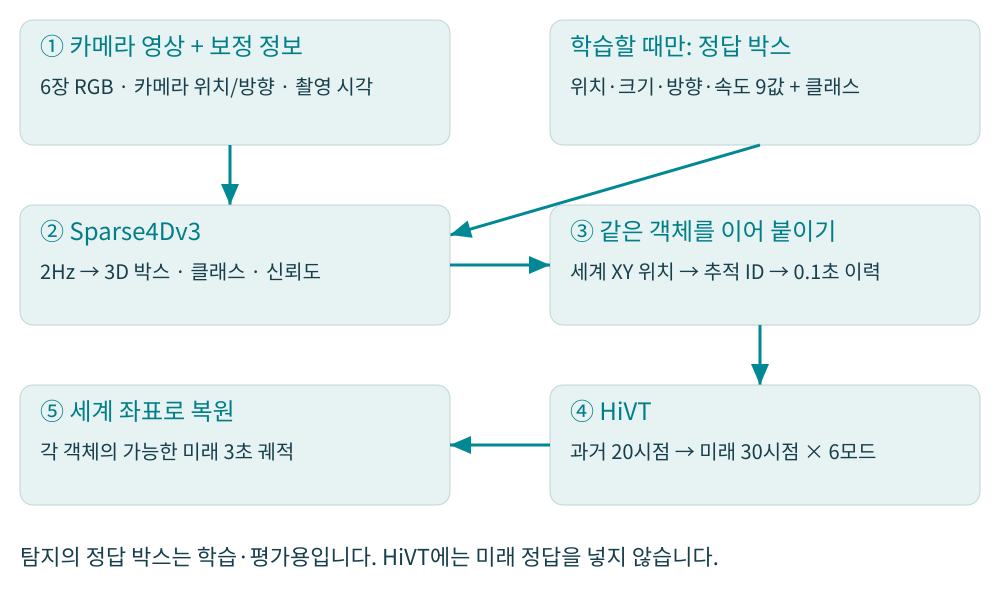
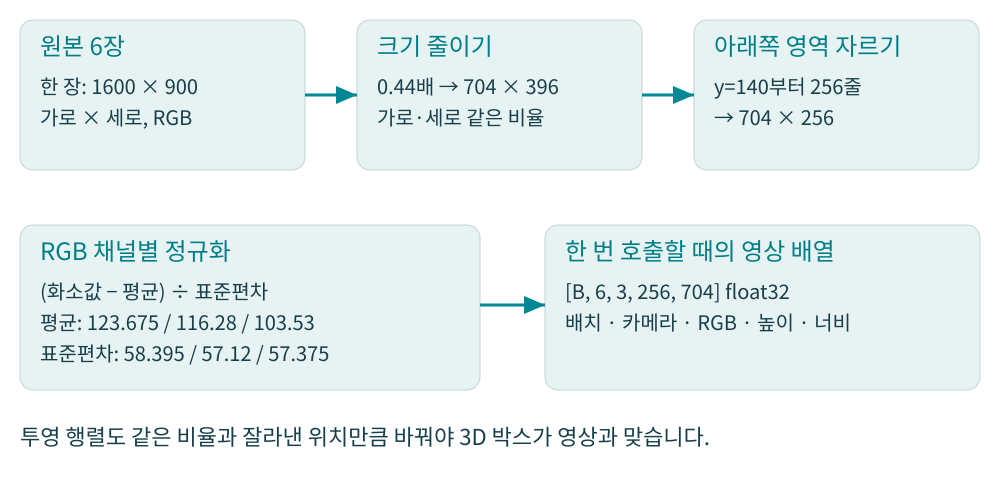
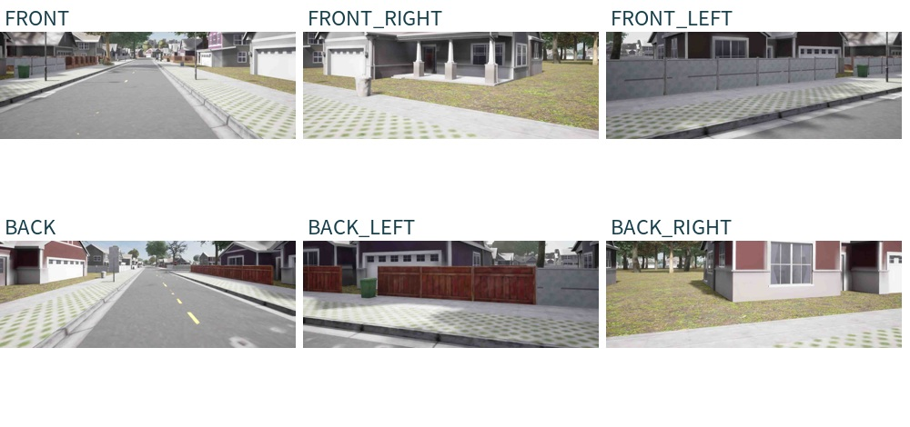
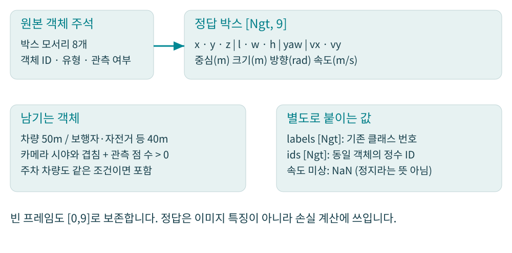
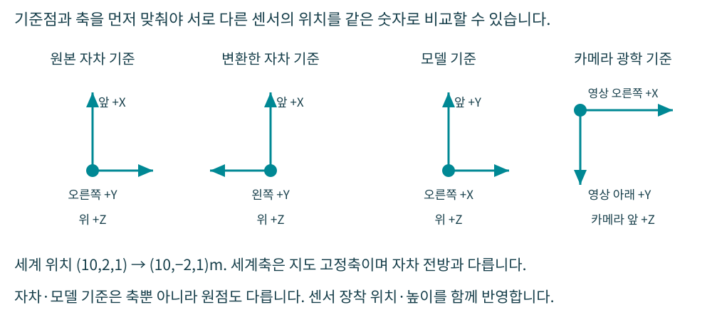
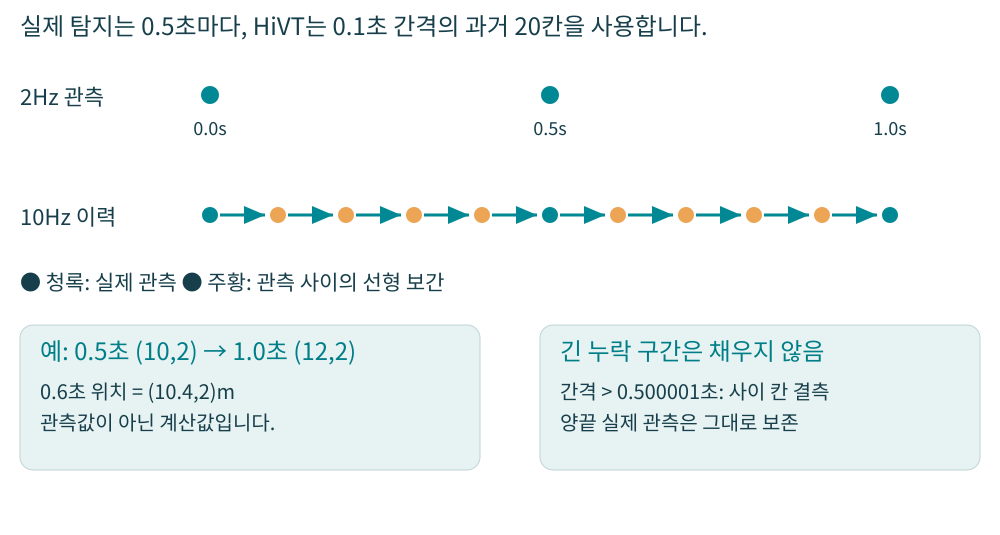
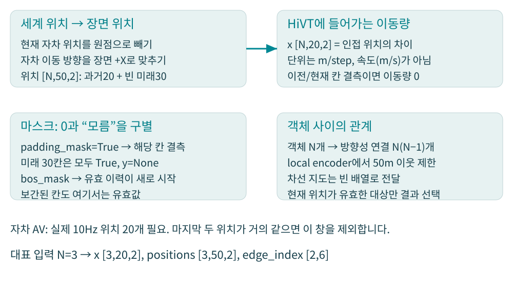
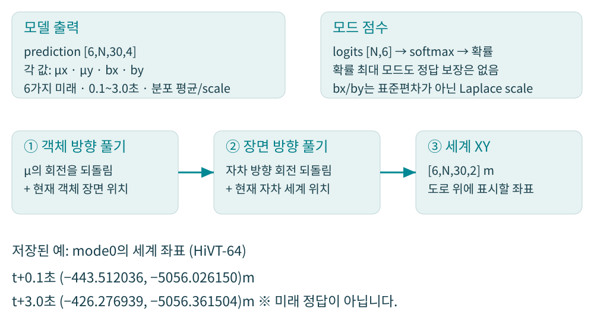

# Sparse4D → HiVT
## 1. 카메라에서 미래 궤적까지

**Bench2Drive 영상으로 미세조정한 2Hz Sparse4Dv3와 HiVT를 연결한 인계 자료입니다.** Sparse4D는 지금 주변에 무엇이 어디 있는지 찾고, HiVT는 같은 객체의 과거 이동을 보고 가능한 미래 궤적을 냅니다.

|이번에 전달하는 것|별도로 준비할 것|
|---|---|
|모델 코드, 데이터 변환·연결 코드, 설정, 저장된 입출력 예제|**Sparse4D 가중치만 별도 제공합니다.**|
|2Hz 미세조정 조건과 이전 실험 결과 설명|HiVT 가중치는 포함·제공하지 않습니다. 새 추론에는 수신자가 호환 가중치를 확보해야 합니다.|

선정 모델은 총 17epoch 중 검증 손실이 가장 낮은 **epoch12**입니다. 지금 별도로 진행하는 10Hz 모델과 다릅니다. 이 문서는 실행 순서 대신 **값의 의미와 변환 과정**을 설명합니다. 명령과 설치 방법은 각 코드 저장소의 README에서 확인합니다.

## 2. 여섯 장의 영상은 어떤 배열이 되는가

한 시점의 카메라 순서는 FRONT → FRONT_RIGHT → FRONT_LEFT → BACK → BACK_LEFT → BACK_RIGHT입니다. **영상과 카메라 투영 행렬이 반드시 같은 순서**여야 합니다. 모델 입력에는 LiDAR 점군·Depth 영상을 넣지 않습니다.

*대표 클립 첫 시점의 실제 저장 캐시입니다. 이미 704×256으로 처리된 영상이며, 원본 1600×900 썸네일이 아닙니다.*

정규화 영상을 매번 계산하지 않도록 RGB 정수 캐시와 채널별 변환표를 저장합니다. 과거 전처리에서는 공식 입력과 float32 값이 정확히 같은지 비교했습니다. 학습도 같은 고정 기하 처리를 사용하고, 모델 내부 GridMask는 별도로 적용합니다.

## 3. 정답 박스와 좌표축을 맞추는 이유

카메라에서는 오른쪽·아래·앞이 각각 X·Y·Z입니다. 모델의 3D 점을 이 축으로 옮긴 다음 카메라 내부 행렬로 픽셀 위치를 얻습니다. **Y 부호 하나만 바꾸고 나머지 방향·카메라 행렬을 그대로 두면 영상과 박스가 어긋납니다.**

속도는 원본 10Hz 위치 차이에서 먼저 구한 뒤 2Hz 시점을 선택합니다. GT는 학습 손실과 탐지 평가에만 쓰며, 추론 입력에는 정답 박스나 정답 ID를 넣지 않습니다. 카메라 시야와 겹친다는 조건은 다른 객체에 가려지지 않았다는 보장은 아닙니다.

## 4. 탐지 결과를 같은 객체의 시간 이력으로

Sparse4D는 한 시점에 박스 **[300,10]**과 신뢰도·클래스를 반환합니다. 10값은 중심 XYZ·크기 LWH·yaw·속도 XYZ이며, HiVT에는 이 배열을 직접 넣지 않고 **세계 XY 이력 → 장면 XY 이동량 [N,20,2]**으로 바꿉니다. 박스의 중심·방향·속도를 공통 세계 좌표로 옮긴 뒤, **신뢰도 0.2 이상**의 객체를 별도 추적기로 연결합니다. 같은 클래스에서 예상 중심과의 거리가 4m 미만인 후보를 대응시키며, 마지막 관측 후 1초를 넘기면 활성 추적 대상에서 제거합니다. 정답 ID로 추적을 보정하지 않습니다.

현재를 t라고 하면 HiVT의 과거 입력은 **t−1.9초부터 t까지 20칸**입니다. 현재 이후의 탐지나 미래 정답은 쓰지 않고, 실제 관측 사이에서만 보간합니다. 관측 범위 밖으로 연장하지 않습니다. 긴 누락 뒤 다시 관측된 끝점도 실제 값이므로 남깁니다.

|값이 생긴 이유|입력에서의 처리|
|---|---|
|실제로 탐지된 위치|유효 위치|
|0.5초 이하의 두 관측 사이 보간|유효 위치. 별도 보간 표시 없이 전달|
|긴 누락·관측 범위 바깥|결측 마스크로 표시|

보간이 10Hz의 새로운 관측 정보를 만드는 것은 아닙니다. 급회전·가속은 두 관측 사이에서 놓칠 수 있고, 추적 ID 오연결도 남아 있습니다.

## 5. HiVT는 위치가 아니라 무엇을 받는가

현재 자차 위치를 원점으로 삼아 숫자 크기를 줄이고, 이동 방향을 맞춰 장면의 방향 차이를 없앱니다. 각 객체의 최근 이동 방향도 함께 전달합니다. **N은 자차를 포함한 객체 수이며, GT 객체 수와 다릅니다.**

|실제 저장 입력의 한 예|값|
|---|---|
|이력 종료 / 객체 수|2.0초 / N=3|
|자차 / 대표 대상 행 번호|0 / 2|
|자차 세계 원점|[−457.040924, −5055.928711]m|
|장면 방향|−0.00501878rad|
|대상의 현재 장면 위치|[13.062359, −0.024287]m|
|마지막 한 칸의 이동량|[0.431561, −0.001252]m/step|

마지막 값은 0.1초 동안의 이동입니다. 속도로 읽으려면 0.1초로 나누지만 **모델에는 나누지 않은 이동량 그대로** 넣습니다. detector의 박스 크기·Z·신뢰도·클래스·속도를 추가 feature로 붙이는 방식은 아닙니다.

## 6. 여섯 가지 미래를 세계 좌표로 되돌리기

HiVT-64와 HiVT-128은 내부 표현 차원이 각각 64·128인 모델입니다. 둘 다 **미래 30시점, 6가지 모드**를 냅니다. 30개 위치를 한 궤적으로 보면 앞으로 3초를 나타냅니다.

저장된 대표 HiVT-64 출력의 대상 객체 모드 확률은 다음과 같습니다.

|모드|0|1|2|3|4|5|
|---|---:|---:|---:|---:|---:|---:|
|확률|0.124373|0.055247|0.174756|0.169680|0.234032|0.241912|

세계 위치를 만들 때는 **객체 방향 → 장면 방향** 순으로 회전을 되돌리고 각 원점을 더합니다. 복원 대상은 분포 평균 μ의 XY입니다. scale 두 값을 그대로 세계 좌표의 표준편차로 읽으면 안 됩니다.

이 숫자는 이전 실험에서 저장된 실제 출력입니다. 이번 문서 작성 과정에서 신경망을 다시 실행한 결과나 미래 정답은 아닙니다.

## 7. 어디까지 확인된 결과인가

|이전 실험의 결과|해석|
|---|---|
|학습835 / 검증221 / 평가44클립|Town·Route 그룹을 분리. 같은 Town은 여러 분할에 존재|
|epoch12 검증 loss 8.4877842531|전체221클립 손실 최저. 13~17epoch 미개선 후 종료|
|평가44클립 mAP **80.6114%**|GT가 있는 car·truck·pedestrian·bicycle 4클래스 평균|
|HiVT **528회** 실행|미세조정 전·후 × 44클립 × 3창 × 2모델의 과거 연결 실행|

**확인한 것:** 저장된 탐지 결과가 HiVT 입력으로 변환되고, 정해진 형상의 유한한 미래 좌표를 낼 수 있다는 연결 가능성입니다.

**아직 확인하지 않은 것:** Bench2Drive 미래 정답 대비 ADE/FDE·실패율, 지도 포함 성능, 실제 주행 안전성입니다. 차선 지도는 빈 입력이고 HiVT를 Bench2Drive로 재학습하지 않았습니다. 전·후 탐지가 달라 선택된 대상·시각도 달라질 수 있습니다.

80.6114%는 탐지 점수이지 미래 궤적 정확도나 주행 점수가 아닙니다. 과거 학습에는 미상 속도의 matching 비용 처리 한계가 있으며, 이번 인계 정리에서 가중치를 다시 학습하거나 기존 신경망 실험을 재실행하지 않았습니다.
